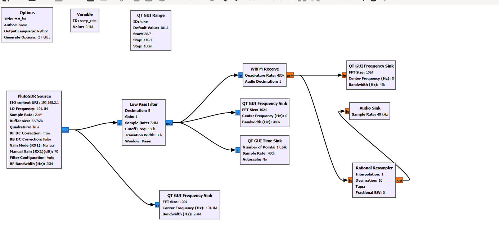
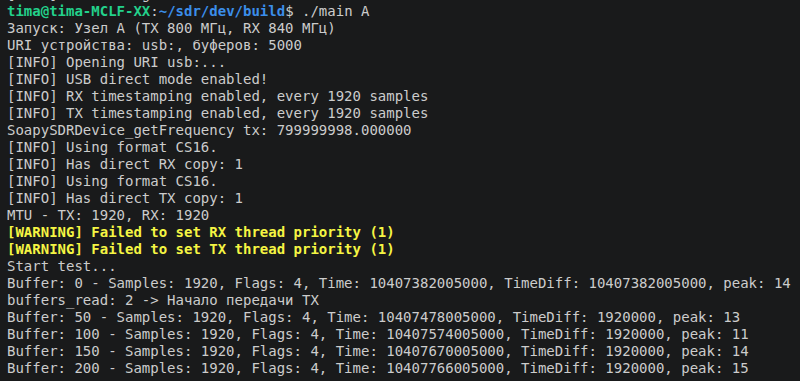
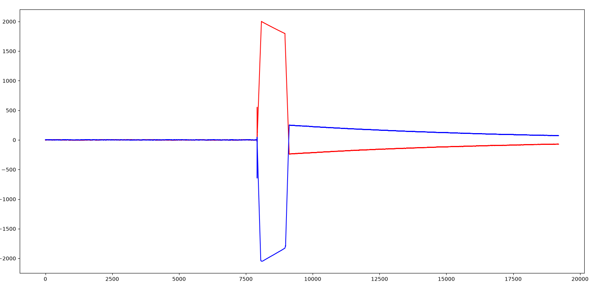
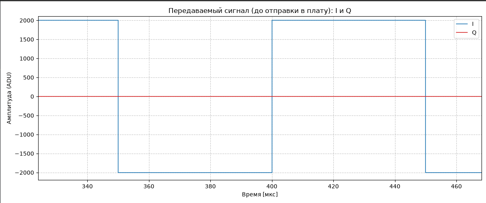
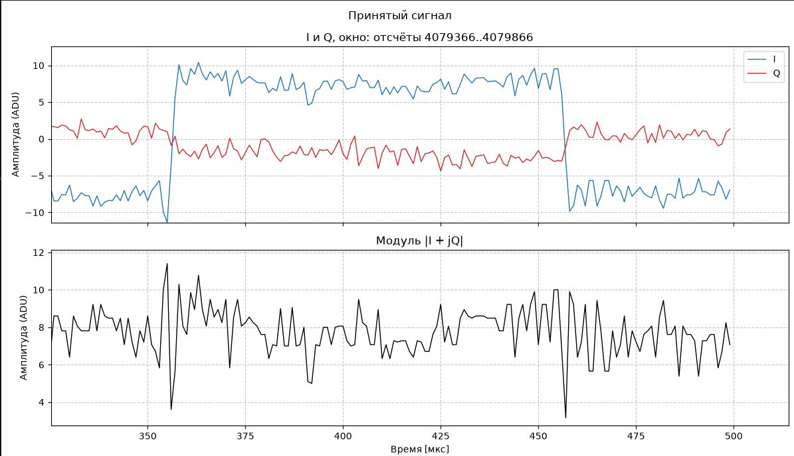
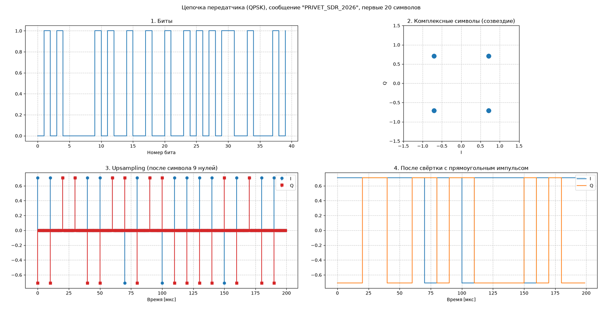
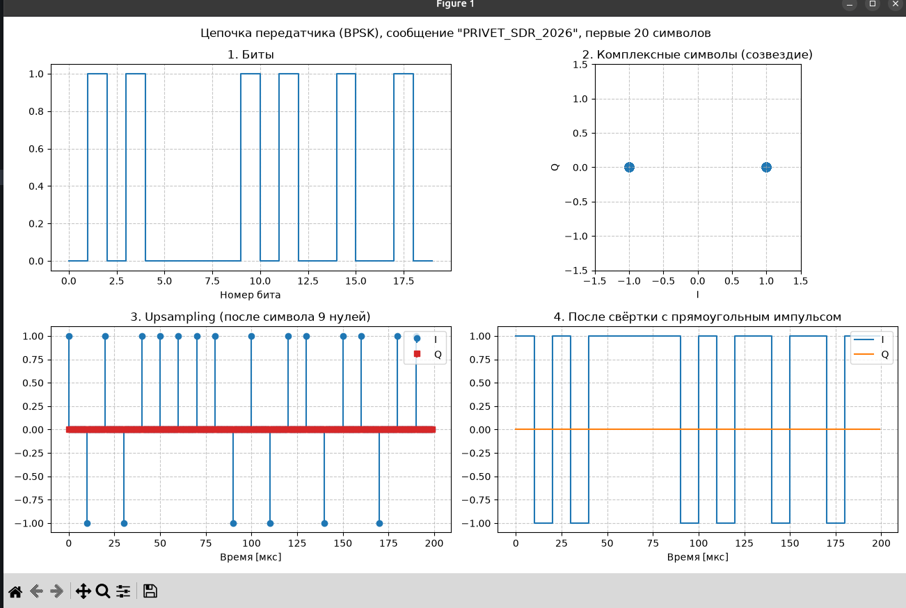
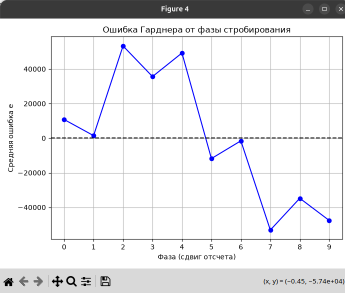
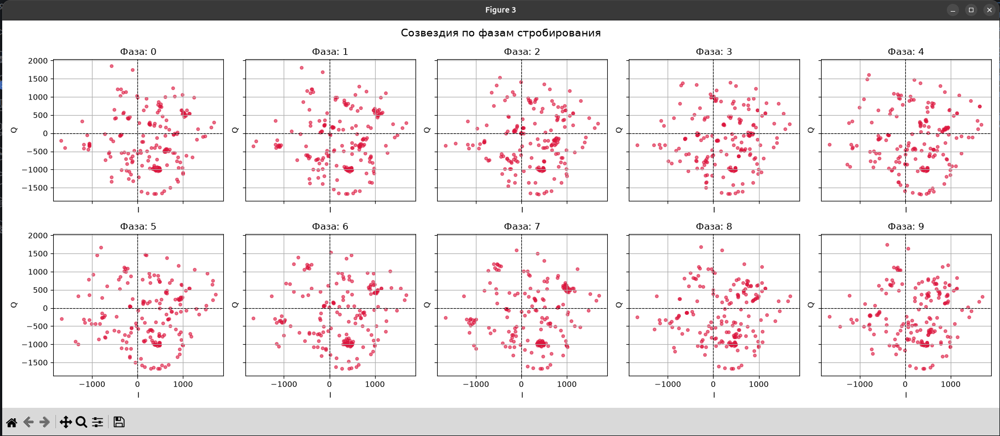
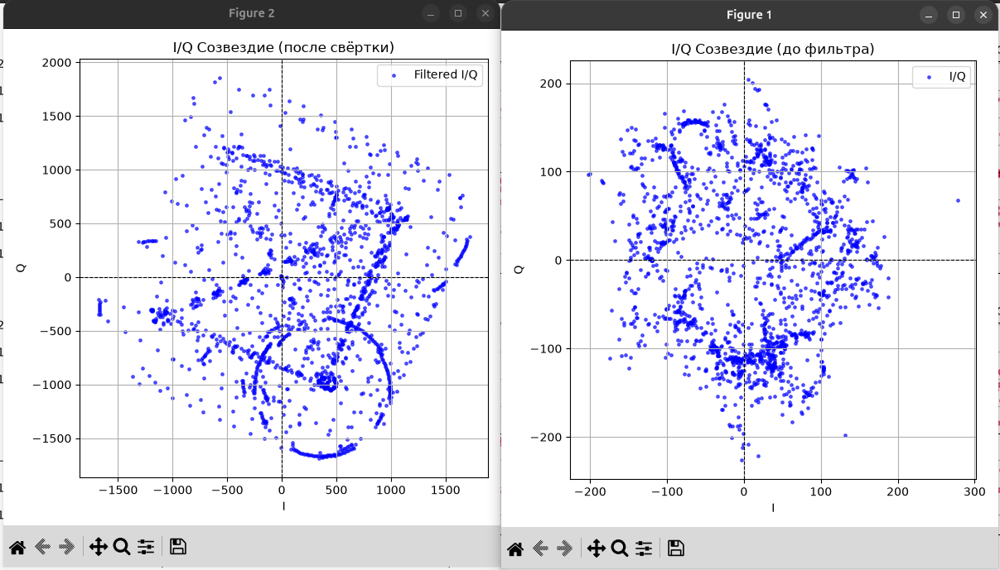

## Практика №1
    GNU Radio. Построение FM-радиоприемника.
    Вводное занятие, первый запуск и настройка GNU Radio.

## Практика №2 
    Поиск радио с помощью GNU Radio.
## Практика №3
    Начало работы с кодом для SDR, установка библиотек и первый запуск.

## Практика №4
    Знакомство с библиотеками Soapy SDR, Libio для работы с Adalm Pluto SDR. Инициализация SDR-устройства. Работа с буфером: получение цифровых IQ-отсчетов.

## Практика №5
    Работа с двумя SDR, передача с одного SDR на другой.

## Практика №6
Передача текстового сообщения между двумя SDR с модуляцией BPSK и QPSK. Передатчик и приёмник это один и тот же исполняемый файл, роль выбирается аргументом при запуске.

1. Генератор битов: сообщение (ASCII) переводится в биты, старший бит первым.
2. Модуляция в комплексные символы: BPSK, QPSK
3. Upsampling: после каждого символа вставляется 9 нулей 
4. Свёртка с прямоугольным импульсом из 10 единиц: каждый символ растягивается на 10 отсчётов.

### Запуск
На ПК с передатчиком:

    ./main Tx --freq 1 bpsk      # или qpsk

На ПК с приёмником (когда передатчик уже работает):

    ./main Rx --freq 1
    python3 main.py

